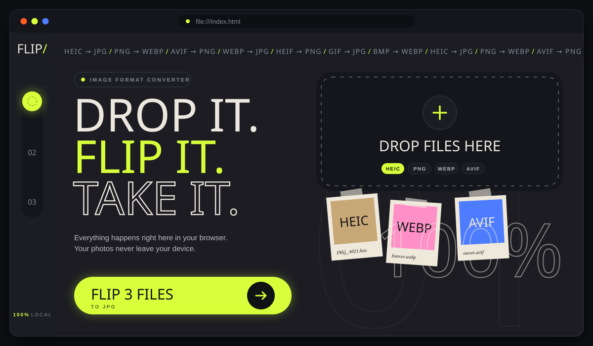
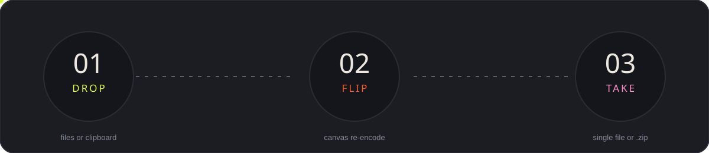

<div align="center">


<br>

### **[Features](#features)** &nbsp;/&nbsp; **[Preview](#preview)** &nbsp;/&nbsp; **[Formats](#formats)** &nbsp;/&nbsp; **[Quick start](#quick-start)** &nbsp;/&nbsp; **[Stack](#stack)** &nbsp;/&nbsp; **[FAQ](#faq)**

<br>

**HEIC off your iPhone. WEBP from the web. PNG, AVIF, GIF, BMP.**
<br>
**Flip any of them into JPG, PNG or WEBP, right in your browser.**

<br>


</div>

<br>

## Preview

<div align="center">



<sub>Polaroids drop in, the dial slides between steps, and the percentage fills with volt.</sub>

</div>

<br>

## How it works



<table>
<tr>
<td width="33%" valign="top">

**01 / Drop it**

Throw files at the page, click to browse, or paste from your clipboard. The whole window is a drop zone.

</td>
<td width="33%" valign="top">

**02 / Flip it**

Pick a format, quality and max size. Your browser decodes and re-encodes every image on a canvas.

</td>
<td width="33%" valign="top">

**03 / Take it**

Download files one by one, or take the whole pile as a single `.zip`.

</td>
</tr>
</table>

<br>

## Features

| | |
|---|---|
| **Local only** | Conversion runs on a `<canvas>` in your browser. Zero uploads, zero tracking. |
| **HEIC and HEIF** | iPhone photos decode through `heic2any`, so they open anywhere. |
| **Batch it** | Drop a whole pile and convert it in one go. Remove single files or clear everything. |
| **Quality slider** | 40 to 100 percent for JPG and WEBP. PNG is lossless, so the slider switches itself off. |
| **Max size** | Keep Original, or cap the longest edge at 4K, 2K or 1080. |
| **Drag, drop, paste** | Drop anywhere on the page, or paste straight from the clipboard. |
| **One-click zip** | Download all bundles everything with JSZip. |
| **Honest stats** | See file count, size before, size after and the percentage saved or gained. |

<br>

## Formats

<table>
<tr>
<td align="center" width="50%">

#### IN

`HEIC` &nbsp; `HEIF` &nbsp; `JPG` &nbsp; `PNG`
<br>
`WEBP` &nbsp; `AVIF` &nbsp; `GIF` &nbsp; `BMP`

<sub>Anything your browser can decode also works.</sub>

</td>
<td align="center" width="50%">

#### OUT

`JPG` &nbsp; `PNG` &nbsp; `WEBP`

<sub>Pick one per batch.</sub>

</td>
</tr>
</table>

<sub>Animated GIFs are flattened to a single frame. HEIC and HEIF are decoded by `heic2any`. Everything else uses the browser's native decoder, so AVIF and WEBP input depends on your browser version.</sub>

<br>

## Quick start

```bash
git clone https://github.com/kxngHADES/image-converter.git
cd image-converter
```

Then open `index.html` in your browser. There is no `npm install`, no bundler and no config.

<br>

## Stack

<div align="center">


</div>

| Piece | Job |
|---|---|
| **GSAP and Draggable** | The loader, the rail dial, magnetic buttons and draggable polaroids |
| **JSZip** | Bundles the download |
| **heic2any** | HEIC and HEIF decoding, loaded from a CDN |
| **Canvas API** | Resizing and encoding |
| **Anton, Permanent Marker, Space Grotesk** | Type, with neumorphic shadows, film grain and a lot of tape |

<br>

## Palette

<div align="center">


<sub>`#D7FF3A` &nbsp; `#FF5B23` &nbsp; `#FF8FC7` &nbsp; `#4D7CFF` &nbsp; `#1B1D23`</sub>

</div>

<br>

## FAQ

<details>
<summary><b>Do my photos get uploaded anywhere?</b></summary>
<br>
No. There is no server. Decoding, resizing, encoding and zipping all happen in your browser tab. The only network requests are the libraries and fonts loaded from CDNs.
</details>

<details>
<summary><b>Why is the first HEIC conversion slow?</b></summary>
<br>
The HEIC decoder loads from a CDN the first time. On a slow connection that can take a few seconds. After that it is cached.
</details>

<details>
<summary><b>Why did my PNG ignore the quality slider?</b></summary>
<br>
PNG is lossless, so there is nothing to trade off. The slider greys out when PNG is selected.
</details>

<details>
<summary><b>Does it work on a phone?</b></summary>
<br>
Yes. The rail turns into a bottom bar. The parallax stickers, custom cursor and magnetic buttons need a mouse, so they only appear on desktop.
</details>

<details>
<summary><b>Does it respect reduced motion?</b></summary>
<br>
Yes. With <code>prefers-reduced-motion</code> on, the grain and looping animations switch off and the rest speeds up.
</details>

<br>

## License

Free to use, remix and flip.

<br>

<div align="center">

### Your files never left this tab.

<sub>**FLIP/** &nbsp;/&nbsp; built with pixels, not platforms.</sub>

</div>
